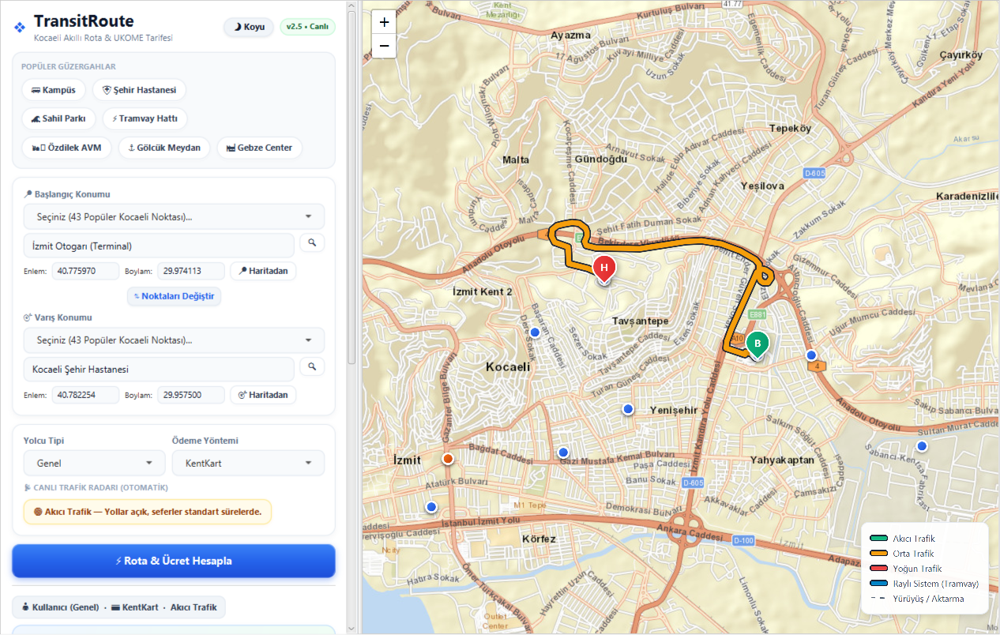
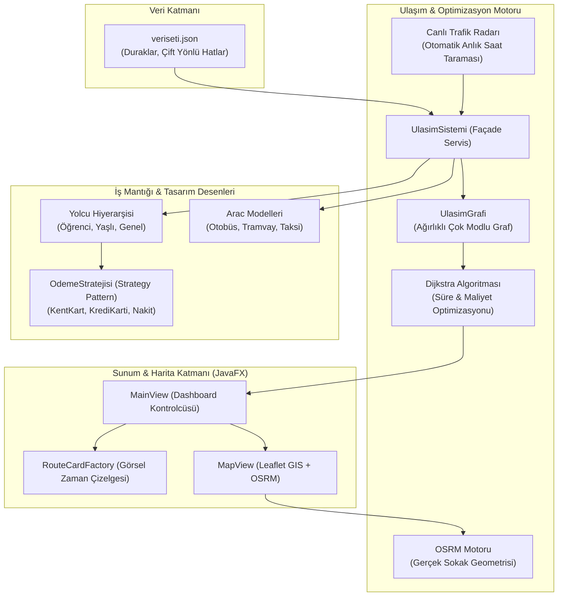

# TransitRoute — Akıllı Kentsel Rota & Çok Modlu Ulaşım Optimizasyon Platformu


**TransitRoute**, kentsel ulaşım ağlarında raylı sistemler (tramvay), otobüs hatları, taksi ve yürüme etaplarını bir arada modelleyen, Dijkstra graf algoritması ve OSRM sokak rotalama motoru tabanlı çok modlu (*multimodal*) bir rota ve ücret optimizasyon platformudur.

Google Haritalar mantığında **otomatik canlı trafik taraması**, gerçek sokak ve viraj geometrisi, yolcu tarifeleri (öğrenci, yaşlı, genel), ödeme stratejileri (KentKart, kredi kartı, nakit) ve çevresel etki (CO₂ tasarrufu ve kalori) analizlerini harmanlayarak kullanıcıya en hızlı ve en ekonomik alternatifleri interaktif GIS haritasında sunar.

---

## 📸 Uygulama Arayüzü & Ekran Görüntüleri

### Ana Dashboard & OSRM Sokak Rotalama Görünümü


### 🖼️ Farklı Güzergah & Senaryo Görselleri

| 🏛️ Kampüs Hattı (Otogar ➔ Umuttepe) | 🌊 Sahil Parkı Hattı (Yahya Kaptan ➔ Sekapark) |
|:---:|:---:|
|  |  |
| *Tramvay aktarmalı, virajlı cadde güzergahı* | *Sahil boyunca uzanan kıvrımlı otobüs hattı* |

| 🏬 AVM & Alışveriş Hattı (Halkevi ➔ Symbol AVM) | ⚡ Raylı Sistem Hattı (Otogar ➔ Halkevi) |
|:---:|:---:|
|  |  |
| *D-100 karayolu bağlantılı çok modlu rota* | *Trafikten etkilenmeyen tam zamanında tramvay hattı* |

| 🧭 Umuttepe ➔ Şehir Merkezi Güzergahı |
|:---:|
|  |
| *Yüksek rakımlı kampüsten şehir merkezine iniş güzergahı* |

---

## 🚀 Öne Çıkan Özellikler

### 1. OSRM ile Gerçek Sokak & Viraj Rotalaması
* Kuş uçuşu cetvel çizgileri yerine, **Open Source Routing Machine (OSRM)** ile caddelerden, köprülerden ve kavşaklardan geçen gerçek dünya yol geometrisi çizilir.
* Yürüyüş etapları için yaya yolları (`walking`), araç etapları için karayolu (`driving`) profilleri işletilir.

### 2. Google Haritalar Tarzı Otomatik Canlı Trafik Radarı
* Kullanıcıya manuel seçim yaptırmaz; sistem **anlık yerel saat ve pik saat modellerini otomatik tarar**:
  * **Sabah / Akşam Yoğunluğu (🔴 / 🟡):** Otobüs ve taksilerde gecikme ve taksi dur-kalk bekleme maliyeti artar.
  * **Raylı Sistem Avantajı:** Tramvay karayolu trafiğinden bağımsız çalıştığı için yoğun saatlerde süre avantajıyla otomatik olarak ilk sıraya yerleşir.

### 3. Çok Modlu Graf & Dijkstra Optimizasyon Motoru
* Duraklar, aktarma istasyonları ve bağlantılar çift yönlü ağırlıklı bir graf üzerinde modellenmiştir.
* İlk/son kilometre (*first/last mile*) yürüme ve taksi entegrasyonu otomatik işletilir.
* Hem **en hızlı seyahat süresi** hem de **en düşük maliyet** alternatifleri listelenir.

### 4. Zengin Yolcu & Ödeme Stratejileri (GoF Patterns)
* **Strategy Pattern:** `OdemeStratejisi` ile *KentKart*, *Kredi Kartı* ve *Nakit* dinamik hesaplanır.
* **Polymorphism:** *Öğrenci* (%50 indirim), *Yaşlı* (ilk 20 biniş ücretsiz, sonrasında %50 indirim) ve *Genel Yolcu* tarifeleri uygulanır.

### 5. Kesintisiz Leaflet GIS Haritası
* Humanitarian OpenStreetMap (HOT) yüksek çözünürlüklü katmanı.
* Zoom yapıldığında gri kalmayan donanım optimizasyonlu altyapı.
* Duraklara tıklandığında açılan interaktif popup'larla tek tıkla başlangıç veya hedef belirleme.

### 6. Çevresel Etki & Bütçe Tasarrufu
* **Tasarruf Analizi:** Direkt taksiye kıyasla net bütçe kazancı (TL).
* **Karbon Ayak İzi (CO₂):** Önlenen karbon salımı (gram).
* **Kalori Metriği:** Yürüyüş etaplarında harcanan kalori (kcal).

---

## 🏗️ Mimari & Tasarım Desenleri



---

## 🛠️ Teknoloji Yığını

* **Dil & Çekirdek:** Java 21+
* **Arayüz:** JavaFX 26 (`javafx-controls`, `javafx-web`)
* **CBS / Harita:** Leaflet JS + OpenStreetMap (HOT Katmanı) + OSRM API
* **Veri İşleme:** `org.json` (JSON-Java)
* **Geocoding:** OpenStreetMap Nominatim REST API
* **Derleme Aracı:** Apache Maven (Maven Wrapper)

---

## 💻 Çalıştırma ve Kurulum

### Hızlı Başlatma (Windows)
Proje kök dizinindeki başlatıcıya çift tıklamanız yeterlidir:

```cmd
start.bat
```
> Önceden derlenmiş sınıflar mevcutsa **1 saniyede doğrudan açılır**, gereksiz yere her seferinde yeniden derleme yapmaz.

### Komut Satırı ile Çalıştırma
```bash
# Bağımlılıkları derle ve paketle
mvnw.cmd package

# Uygulamayı başlat
java -cp "target\classes;target\dependency\*" com.ulasim.hesaplama.Launcher
```

---

## 📂 Proje Dizin Yapısı

```
ulasim-ucret-hesaplama-sistemi/
├── docs/                                  # Farklı güzergahlara ait ekran görüntüleri
│   ├── 01-kampus-hatti.png
│   ├── 02-sahil-parki.png
│   ├── 03-avm-hatti.png
│   ├── 04-rayli-sistem.png
│   └── 05-umuttepe-sehir-merkezi.png
├── src/
│   ├── main/
│   │   ├── java/com/ulasim/hesaplama/
│   │   │   ├── App.java                   # JavaFX Giriş Noktası
│   │   │   ├── Launcher.java              # Classpath başlatıcı
│   │   │   ├── domain/                    # Araç ve yolcu modelleri
│   │   │   ├── graph/                     # Dijkstra ve graf motoru
│   │   │   ├── model/                     # Rota, Konum, Durak, TrafikDurumu
│   │   │   ├── payment/                   # Ödeme stratejileri (KentKart, Nakit, Kredi)
│   │   │   ├── service/                   # UlasimSistemi ve Geocoder
│   │   │   └── ui/                        # MainView, RouteCardFactory, ScreenshotExporter
│   │   └── resources/
│   │       ├── css/app.css                # Tasarım sistemi ve stiller
│   │       ├── map/                       # Leaflet harita ve OSRM şablonu
│   │       └── veriseti.json              # Şehir ulaşım şebekesi verisi
├── screenshot.png                         # Ana vitrin ekran görüntüsü
├── start.bat                              # Hızlı başlatma betiği
└── pom.xml                                # Maven konfigürasyonu
```

---

## 📄 Lisans
Bu proje eğitim ve portföy amaçlı geliştirilmiş açık kaynaklı bir kentsel ulaşım optimizasyon simülasyonudur.
