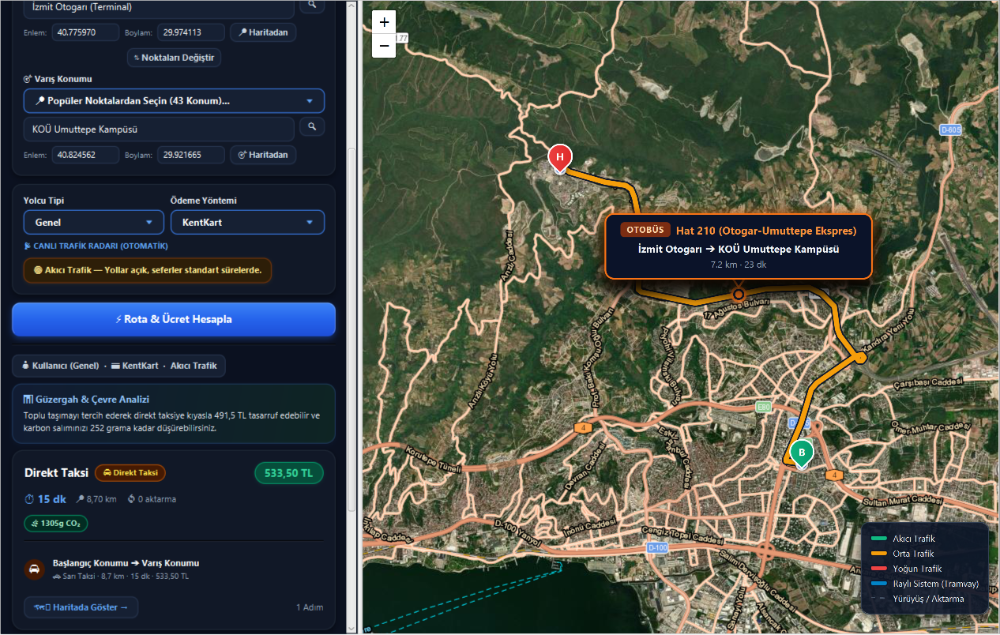
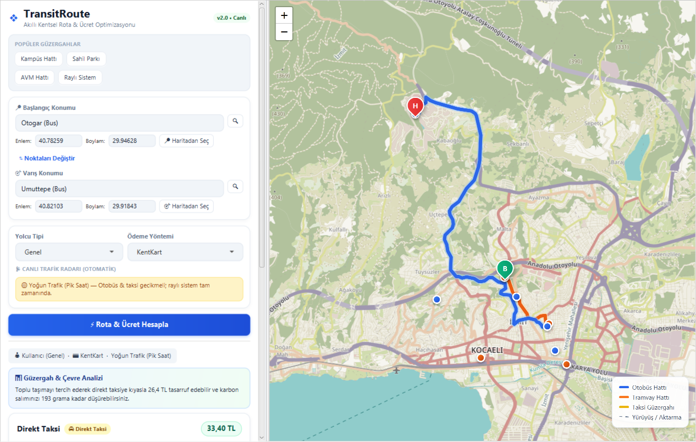
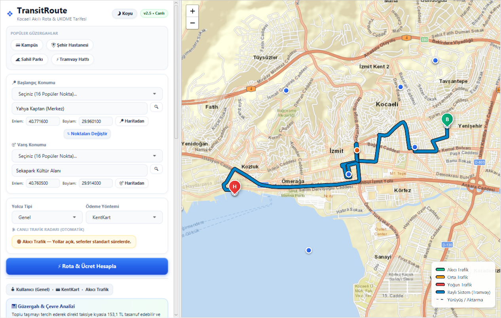
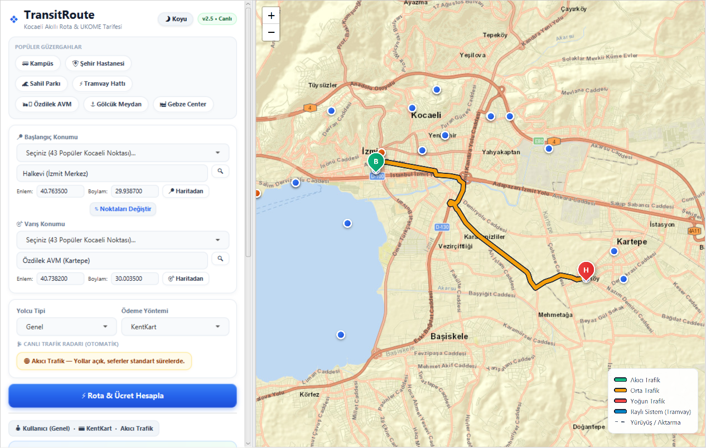
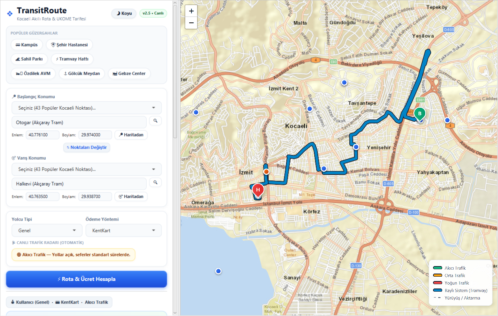

# TransitRoute — Akıllı Kentsel Rota & Ücret Optimizasyonu


**TransitRoute**, kentsel ulaşım ağlarında otobüs, raylı sistem (tramvay), taksi ve yürüme etaplarını **Dijkstra graf algoritması** ve **OSRM sokak geometrisi** ile harmanlayan çok modlu (*multimodal*) bir rota ve ücret optimizasyon platformudur.

Anlık trafik yoğunluğunu otomatik tarar, güncel UKOME taksi & toplu taşıma tarifeleriyle gerçekçi seyahat süresi, bütçe tasarrufu ve karbon ayak izi (CO₂) analizlerini interaktif haritada sunar.

---

## 📸 Uygulama Arayüzü

| ☀️ Aydınlık Mod (Esri World Street Map) | 🌙 Koyu Mod (HD Gece Uydusu & Ulaşım Ağı Hibriti) |
|:---:|:---:|
|  |  |

### 🖼️ Popüler Güzergah Senaryoları

| 🚌 Kampüs Hattı (Otogar ➔ Umuttepe) | 🌊 Sahil Parkı (Yahya Kaptan ➔ Sekapark) |
|:---:|:---:|
|  |  |

| 🛍️ AVM Hattı (Halkevi ➔ Özdilek AVM Kartepe) | ⚡ Tramvay Hattı (Otogar ➔ Halkevi) |
|:---:|:---:|
|  |  |

---

## ✨ Öne Çıkan Özellikler

* **Kocaeli Popüler 43 Lokasyon Seçici:** Manuel koordinat girme zahmeti olmadan İzmit, Kartepe (Köseköy, Özdilek AVM, Maşukiye), Gölcük (Donanma, Değirmendere), Körfez (Tütünçiftlik, Yarımca, Hereke), Gebze (Center AVM, GTÜ), Darıca, Çayırova, Dilovası, Karamürsel ve Kandıra (Kerpe) gibi Kocaeli'nin 12 ilçesindeki tüm ana merkezleri açılır menüden tek tıkla seçme imkanı.
* **Resmi Kocaeli UKOME Gerçekçi Tarifeleri:** Kocaeli Büyükşehir Belediyesi UKOME kararlarıyla tam uyumlu belediye otobüsü (42 TL), tramvay (36 TL), taksimetre açılış (55 TL), km başı (55 TL) ve indi-bindi taban ücreti (200 TL). Ara durak başına bilet kesme hatası giderilmiş olup, hat boyunca tek biniş ücreti kuralı ve KentKart aktarma indirimi tam uygulanır.
* **Sadeleştirilmiş Rota Stepper Tasarımı:** Karmaşık ve tekrar eden ara durak kalabalığı yerine `Başlangıç Durağı ➔ Varış Durağı` formatında tek parça etap gösterimi; her etabın altında kullanılan araç (Tramvay, Belediye Otobüsü, Taksi, Yürüme), mesafe, süre ve net ücret dökümü.
* **Aydınlık & Koyu Tema (Light / Dark Mode):** Tek tuşla geçiş yapılabilen `Carbon Midnight` koyu arayüzü (koyu modda yüksek kontrastlı neon ComboBox ve net form metinleri) ve büyüleyici **Esri World Imagery (Uzaydan HD Gece Uydu Görüntüsü & Altın Ulaşım Ağı)** harita altyapısı.
* **Hızlı ve Filigransız Kurumsal Esri GIS:** API anahtarı gerektirmeyen, engellemesiz ve ışık hızında yüklenen harita motoru.
* **Gerçek Sokak Geometrisi (OSRM):** Cetvel gibi düz çizgiler yerine caddeleri, bulvarları, kavşakları ve D-100/TEM otoyol güzergahlarını milimetrik takip eden gerçekçi rota çizimi.
* **Otomatik Canlı Trafik Radarı:** Google Haritalar mantığında; anlık saat dilimine ve pik saat yoğunluklarına göre toplu taşıma ve taksi sürelerini dinamik analiz eden sistem.
* **Çok Modlu Dijkstra Optimizasyonu:** Tramvay, otobüs, taksi ve yürüme etaplarını en hızlı ve en ekonomik kriterlere göre çözer.
* **Çevre & Bütçe Analitiği:** Direkt taksiye kıyasla tasarruf edilen TL, önlenen CO₂ salımı (gram) ve harcanan kalori (kcal).

---

## ⚡ Hızlı Başlatma

### Windows (Tek Tıkla)
Kök dizindeki **`start.bat`** dosyasına çift tıklayın:
```cmd
start.bat
```
*(Önceden derlenmiş sınıflar varsa 1 saniyede doğrudan açılır)*

### Komut Satırı ile Derleme ve Çalıştırma
```bash
# Projeyi derle
mvnw.cmd package

# Başlat
java -cp "target\classes;target\dependency\*" com.ulasim.hesaplama.Launcher
```

---

## 🛠️ Teknolojiler
* **Java 21+** & **JavaFX 26** (`javafx-web`, `javafx-controls`)
* **Leaflet GIS** (HOT OpenStreetMap katmanı) + **OSRM Routing Engine**
* **Dijkstra Graf Optimizasyonu** & **GoF Tasarım Desenleri** (Strategy, Façade)
